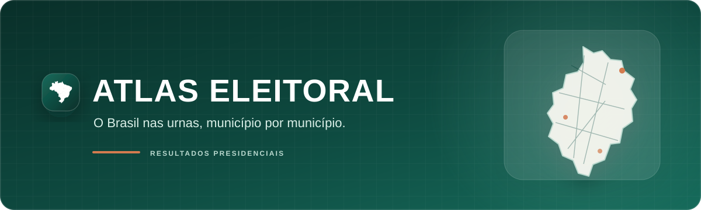
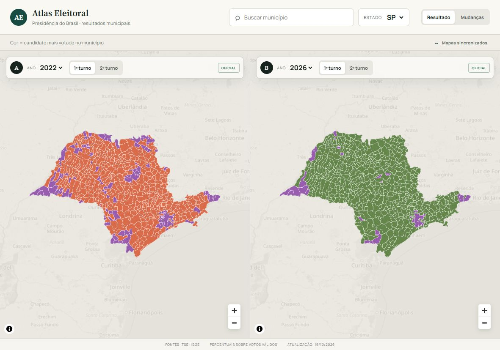

  

  Uma leitura cartográfica, comparativa e responsiva dos resultados das eleições presidenciais brasileiras.

  <a href="https://atlas-eleitoral.pages.dev/"><strong>Acessar o Atlas Eleitoral</strong></a>

  
  
  
  
  

## Sobre o projeto

O **Atlas Eleitoral** transforma resultados oficiais em uma experiência visual para explorar como o Brasil votou, município por município. A interface combina dois mapas comparáveis, filtros eleitorais independentes e detalhes sob demanda para preservar o protagonismo da geografia sem abrir mão da precisão dos dados.

O projeto foi desenhado para funcionar com mouse, teclado e toque, em telas grandes ou compactas, com temas claro e escuro e atenção permanente à acessibilidade.

## O que já está disponível

- **Comparações eleitorais A × B:** eleições e turnos independentes, com mapas lado a lado no desktop e alternância A/B em telas compactas.
- **Resultados municipais:** visualização cartográfica da candidatura mais votada e detalhamento comparativo por município.
- **Modo Mudanças:** leitura das permanências e mudanças entre os pleitos selecionados, com linguagem visual própria.
- **Votação no Exterior:** totais do recorte exterior, lista de países e comparação A × B por país, respeitando a disponibilidade de cada eleição.
- **Modos de leitura:** candidaturas e agrupamento Referência × Demais, com percentuais e cores calculados de forma consistente.
- **Experiência responsiva:** navegação adaptada para desktop, tablet, celular e orientação horizontal.
- **Acessibilidade e preferência do usuário:** operação por teclado, foco visível, movimento reduzido e temas claro, escuro ou conforme o sistema.

## Visão do produto

No comparativo, cada mapa preserva seu próprio ano, turno, referência e recorte. A votação no Exterior é tratada separadamente: votos da Zona Eleitoral do Exterior não são atribuídos a estados ou municípios brasileiros.

## Tecnologias

- React e TypeScript
- Vite
- MapLibre GL JS
- CSS responsivo com design tokens
- Cloudflare Pages

## Dados e metodologia

Os resultados eleitorais têm como fonte os arquivos oficiais do [Tribunal Superior Eleitoral](https://dadosabertos.tse.jus.br/). As geometrias e relações territoriais usam referências do [Instituto Brasileiro de Geografia e Estatística](https://www.ibge.gov.br/).

O processamento consolida os votos presidenciais por município e mantém o Exterior como recorte próprio. Ausência de dados não é interpretada como zero, e turnos ainda não publicados permanecem indisponíveis.

## Roadmap

A evolução planejada organiza a experiência em três modos:

**RESULTADOS | COMPARAÇÃO | MUDANÇAS**

- **Resultados — planejado:** exploração de uma eleição por vez, com análise contextual individual.
- **Comparação — em evolução:** seleção A/B independente; o comparativo atual já está disponível.
- **Mudanças — disponível:** mapa dedicado às diferenças entre os pleitos selecionados.
- **Navegação geográfica progressiva — planejada:** Brasil → macrorregião → estado → município, com totais validados em cada recorte.

Funcionalidades planejadas são apresentadas aqui como direção de produto e não como recursos já concluídos.

## Projeto independente

O Atlas Eleitoral é um projeto independente de visualização e análise. **Não é um serviço oficial do TSE nem do IBGE.** Os órgãos são citados exclusivamente como fontes oficiais dos dados eleitorais e territoriais.

